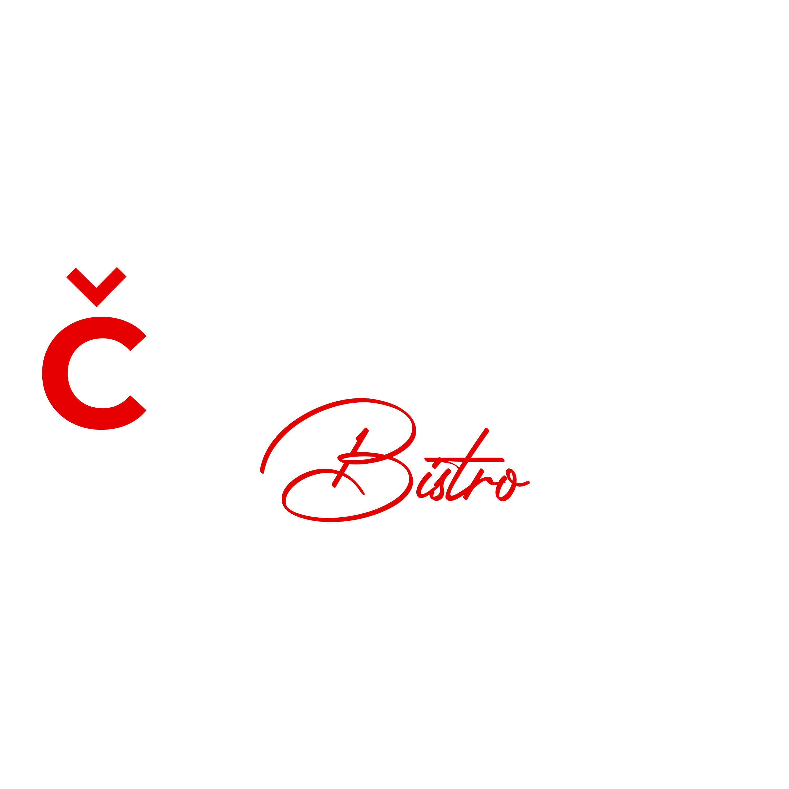

# Cafeino Bistro POS System

A modern, full-stack Point of Sale system designed for Cafeino Bistro coffee shop. Built with FastAPI (backend) and Next.js 14 (frontend), featuring role-based authentication, order management, service tracking, and comprehensive analytics.



## 🌟 Features

### For Waiters
- ⏰ **Clock In/Out System** - Track service hours with live timer
- 🛒 **Order Management** - Create, view, and manage orders
- 📋 **Order History** - View personal order history with filters
- 🎯 **Quick Order Creation** - Intuitive product selection and cart

### For Administrators
- 📊 **Analytics Dashboard** - Revenue trends, order statistics, performance metrics
- 📦 **Product Management** - Full CRUD operations for menu items
- 👥 **Waiter Management** - View service records and attendance
- 📈 **Reports** - Detailed reports on revenue, waiters, and top products
- 🎨 **All Waiter Features** - Plus administrative capabilities

### Technical Features
- 🔐 JWT-based authentication with role-based access control
- 🎨 Modern, animated UI with warm coffee shop aesthetics
- 📱 Fully responsive design (mobile, tablet, desktop)
- ⚡ Fast performance and optimized loading
- 🗄️ MongoDB Atlas cloud database
- 📊 Interactive charts and visualizations
- 🔄 Real-time data updates

## 🏗️ Architecture

```
cafeino/
├── backend/          # FastAPI backend with MongoDB
├── frontend/         # Next.js 14 frontend
└── Logo-Blanc-Rouge.png
```

### Backend Stack
- **FastAPI** - Modern Python web framework
- **MongoDB Atlas** - Cloud database
- **Motor** - Async MongoDB driver
- **JWT** - Authentication
- **Pydantic** - Data validation

### Frontend Stack
- **Next.js 14** - React framework with App Router
- **TypeScript** - Type safety
- **Tailwind CSS** - Styling
- **TanStack Query** - Data fetching
- **Framer Motion** - Animations
- **Recharts** - Charts and analytics

## 🐳 Docker Deployment

You can run the entire project (Frontend, Backend, and MongoDB) with a single command:

```bash
docker-compose up --build
```

Access the applications at:
- **Frontend**: http://localhost:3000
- **Backend**: http://localhost:8000
- **MongoDB**: http://localhost:27017

## 🚀 Quick Start (Local Setup)

### Prerequisites
- Python 3.9+
- Node.js 18+
- MongoDB (Atlas or local)

### Backend Setup

1. **Navigate and Setup:**
```bash
cd backend
python -m venv venv
# Windows: venv\Scripts\activate | Linux/Mac: source venv/bin/activate
pip install -r requirements.txt
```

2. **Configure Environment:**
Create `.env` based on `.env.example` in `backend/`.

3. **Seed & Run:**
```bash
cd app
python seed.py
cd ..
uvicorn app.main:app --reload
```

### Frontend Setup

1. **Navigate and Install:**
```bash
cd frontend
npm install
```

2. **Configure & Run:**
Create `.env.local` with `NEXT_PUBLIC_API_URL=http://localhost:8000`.
```bash
npm run dev
```

Frontend will be available at http://localhost:3000

## 👤 Demo Credentials

After seeding the database, use these credentials:

**Admin Account:**
- Email: `admin@cafeino.com`
- Password: `admin123`

**Waiter Account:**
- Email: `waiter1@cafeino.com`
- Password: `waiter123`

## 📖 Documentation

- [Backend Documentation](backend/README.md)
- [Frontend Documentation](frontend/README.md)
- [API Documentation](http://localhost:8000/docs) (when backend is running)

## 🎨 Design

The application uses a warm coffee shop aesthetic with:
- Primary Color: Saddle Brown (#8B4513)
- Secondary Color: Chocolate (#D2691E)
- Accent Color: Warm Orange (#FF8C42)
- Background: Cornsilk (#FFF8DC)

## 📊 API Endpoints

### Authentication
- `POST /api/auth/login` - Login
- `POST /api/auth/register` - Register user (Admin only)
- `GET /api/auth/me` - Get current user

### Products
- `GET /api/products` - List products
- `POST /api/products` - Create product (Admin only)
- `PUT /api/products/{id}` - Update product (Admin only)
- `DELETE /api/products/{id}` - Delete product (Admin only)

### Orders
- `GET /api/orders` - List orders
- `POST /api/orders` - Create order
- `PUT /api/orders/{id}` - Update order
- `DELETE /api/orders/{id}` - Cancel order

### Services
- `POST /api/services/clock-in` - Clock in
- `POST /api/services/clock-out` - Clock out
- `GET /api/services` - Get service records
- `GET /api/services/date/{date}` - Get services by date (Admin only)

### Reports (Admin only)
- `GET /api/reports/revenue` - Revenue report
- `GET /api/reports/orders` - Order statistics
- `GET /api/reports/waiters` - Waiter performance
- `GET /api/reports/top-products` - Top products

## 🔒 Security

- Password hashing with bcrypt
- JWT token-based authentication
- Role-based access control
- CORS configuration
- Input validation with Pydantic
- Protected routes on frontend

## 🧪 Testing

### Backend
```bash
cd backend
pytest
```

### Frontend
```bash
cd frontend
npm test
```

## 📦 Deployment

### Backend (FastAPI)
- Deploy to Heroku, Railway, or AWS
- Set environment variables
- Use production ASGI server (Gunicorn + Uvicorn)

### Frontend (Next.js)
- Deploy to Vercel (recommended)
- Or build and deploy to any Node.js hosting
- Set `NEXT_PUBLIC_API_URL` environment variable

## 🤝 Contributing

This is a proprietary project for Cafeino Bistro.

## 📝 License

Proprietary - Cafeino Bistro © 2026

## 🐛 Troubleshooting

### Backend Issues
- **MongoDB Connection**: Verify connection string and IP whitelist in MongoDB Atlas
- **Import Errors**: Ensure virtual environment is activated
- **Port Already in Use**: Change port with `--port 8001`

### Frontend Issues
- **API Connection**: Check `NEXT_PUBLIC_API_URL` in `.env.local`
- **Build Errors**: Clear `.next` folder and rebuild
- **Authentication**: Clear localStorage and login again

## 📞 Support

For issues or questions, contact the development team.

---

**Built with ❤️ for Cafeino Bistro**
